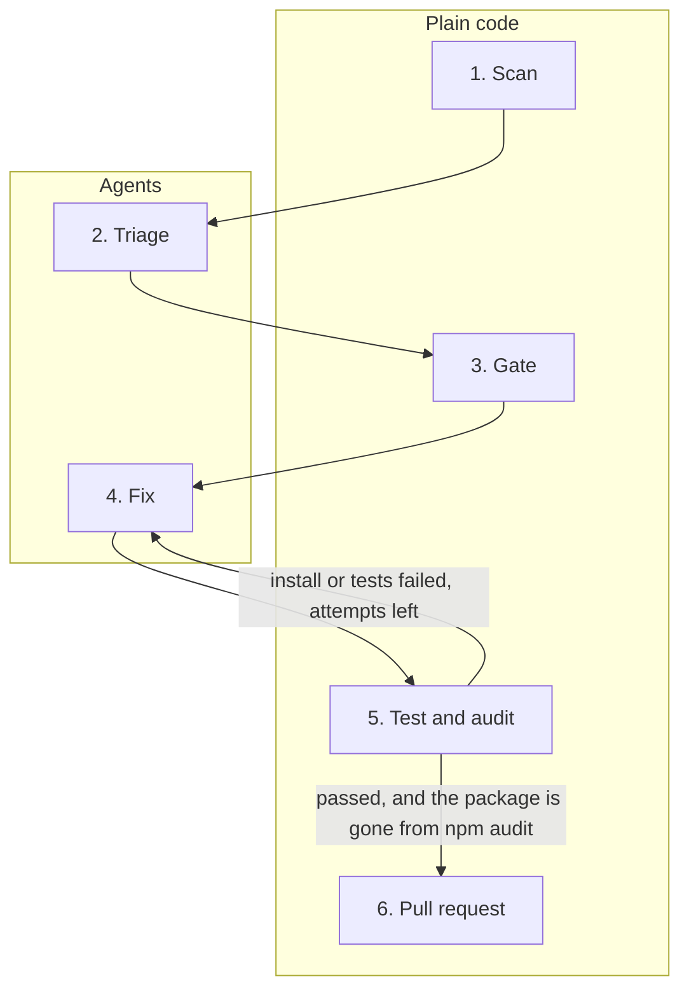

# PatchDesk

## What it is

PatchDesk is a command-line tool for the AppSec team at Hudson Valley Medical Center, a fictional academic medical center. The team scans [hvmc-patient-portal](https://github.com/rgoldenbroit/hvmc-patient-portal). Scanner severity does not say which finding to fix first. Every fix also needs evidence for change review. PatchDesk reads `npm audit`, asks an agent whether the app's own code imports each package, and asks a person which fixes to approve. For each approved package it edits a separate checkout, runs the tests and a new audit, and opens a pull request. A person reviews that pull request before it reaches `main`.

## How it works

`main` in `src/cli.ts` runs six steps. Scan, the gate, the test and audit, and the pull request are plain code. Triage and the fix are agents, through `Agent.create` in `@cursor/sdk`. Plain code creates a git worktree at `src/fix.ts:90` before the fix agent starts. A failed `npm install` or a failed `npm test` is sent back to that agent. It stops after 2 failed attempts. An edit to `package-lock.json` or to a file under `test/` stops with no retry. If `npm audit` still lists the package, the run records a failure and does not open a pull request.



## Trigger to output

`main` calls scan at `src/cli.ts:34`, triage at `src/cli.ts:40`, the gate at `src/cli.ts:60`, and `fixOne` at `src/cli.ts:86`. After those steps it writes the report at `src/cli.ts:94`. The report file is `runs/<runId>.md`, from `writeReport` at `src/report.ts:23`. The same folder has `runs/<runId>.json`. The command prints the report path as its last line.

| Step | Starts | Kind | Produces |
| --- | --- | --- | --- |
| Scan | `src/scan.ts:112` | plain code | One finding per package that has its own advisory: package, severity, installed range, advisories, fix version, and whether the fix is a major upgrade. Saved on the run and printed as a table. |
| Triage | `src/triage.ts:98` | agent | `Agent.create`, then one prompt for every finding. One verdict per package: reachable, `file:line` evidence, priority (`fix-now`, `fix-soon`, or `defer`), and a reason. Checked with zod. Printed as a table. |
| Gate | `src/gate.ts:38` | plain code | One decision per finding, in scan order: `approved`, `skipped`, or `deferred-by-policy`. Asks about `fix-now`, then `fix-soon`, and stops at 2 packages. `defer` is left out. |
| Fix | `src/fix.ts:101` | agent | `Agent.create` in the worktree. Edits `package.json` and app code for that package. Returns a short summary. |
| Test and audit | `src/fix.ts:182` | plain code | A forbidden-path check, `npm install`, and `npm test`. After those pass, `npm audit` runs at `src/fix.ts:115`. Result is tests passed, or a `failure` string. |
| Pull request | `src/fix.ts:124` | plain code | `git add`, commit, and push of branch `patchdesk/<package>-<runId>`, then `gh pr create` at `src/fix.ts:139`. Result is a pull request URL, or a `failure` string. |

## What the agents can and can't do

Both agents are local. Each one loads project settings (`settingSources: ["project"]`). The model id for both is `composer-2.5` (`src/config.ts`).

| Agent | Tools | cwd | Model | What stops it |
| --- | --- | --- | --- | --- |
| Triage (`patchdesk-triage`) | read, grep, glob, ls | The `--repo` directory | `composer-2.5` | The tool list is only those four, so it cannot edit files or run a shell. The reply must be one JSON verdict per scanned package. Zod checks that shape. A bad reply gets one correction prompt. A second bad reply throws. |
| Fix (`patchdesk-fix-<package>`) | read, grep, glob, ls, edit | The worktree under `worktrees/`, not the checkout on `main` | `composer-2.5` | Only those five tools are offered, so it cannot run a shell, delete files, or search the web. It cannot install, test, or push. Plain code rejects `package-lock.json` and any path under `test/`. Plain code runs install, test, and audit. It commits only after the tests pass and the package is gone from `npm audit`. It opens a pull request and leaves `main` for a person. Two failed attempts stop that package. |

The fix agent is created only when npm named a target version and the gate approved that package.

## Run it

You need:

- Node.js 22.13 or newer
- `CURSOR_API_KEY` set in the environment
- `gh` logged in to GitHub

The target repo must be a git checkout with a `main` branch and a GitHub remote. The fix step branches from `main`, and `gh pr create` uses `--base main`.

From this directory:

```
npm install
npm run patchdesk -- run --repo ../hvmc-patient-portal
```

`--triage-only` stops before the approval questions. It still writes the report.

`--yes` approves each selected fix that is not a major upgrade. A major upgrade still asks.

## Decisions

- `src/scan.ts:57` — Drop npm fields we do not use (cvss, cwe, nodes, effects).
- `src/scan.ts:68` — Allow up to 10 MiB of audit JSON.
- `src/scan.ts:85` — Keep packages in the order npm printed them.
- `src/scan.ts:88` — Ignore npm's `isDirect` flag and look at `via` instead.
- `src/scan.ts:123` — `true` and `false` both become fixVersion null and fixIsMajor false.
- `src/scan.ts:127` — Keep `version` and `isSemVerMajor`, and drop `name`.
- `src/scan.ts:150` — Parse the URL and take the last path segment.
- `src/scan.ts:215` — Treat exit code 1 as a finished audit.
- `src/triage.ts:84` — Ask for a JSON array and check it with zod before using it.
- `src/triage.ts:97` — One agent reads every finding in a single prompt.
- `src/triage.ts:102` — Allow only read, grep, glob, and ls.
- `src/triage.ts:130` — Call getUsage before dispose, and keep the verdicts if that call throws.
- `src/config.ts:15` — Keep the approval rules in one object in config.
- `src/gate.ts:44` — Ask in policy order (fix-now, then fix-soon), but return one decision per finding in scan order.
- `src/gate.ts:53` — A major upgrade ignores `--yes`.
- `src/gate.ts:74` — Pair each finding with a verdict by package name.
- `src/gate.ts:89` — Keep the scan order when two packages share a priority.
- `src/gate.ts:95` — Stop after `POLICY.maxFixesPerRun` packages, before the person answers.
- `src/gate.ts:145` — Trim and lowercase, then accept only "y" and "yes".
- `src/fix.ts:50` — Allow up to 10 MiB from git, npm, and gh.
- `src/fix.ts:89` — Do the fix in a new worktree on its own branch.
- `src/fix.ts:100` — Give the fix agent read and edit tools only.
- `src/fix.ts:121` — Commit only after npm test passes and the package is gone from npm audit.
- `src/fix.ts:122` — Open a pull request and stop.
- `src/fix.ts:148` — Call getUsage before dispose, and keep the fix result if that call throws.
- `src/state.ts:32` — Keep the clocks on `timings` instead of wrapping each step.
- `src/state.ts:73` — Pretty-print with a 2-space indent.
- `src/state.ts:88` — Check the file with zod before using it.
- `src/state.ts:113` — Only accept the timestamp id shape.
- `src/state.ts:123` — Put runs in the PatchDesk project directory.
- `src/usage.ts:64` — A usage payload that fails validation uses the same fallback as a throw.
- `src/usage.ts:74` — Any throw from getUsage becomes cost "unavailable" plus the run-result token sum.
- `src/report.ts:164` — Say when the dollar figure is only part of the bill.
- `src/report.ts:195` — Divide by 100 only when writing the report.
- `src/cli.ts:50` — Write the report for a triage-only run too.
- `src/cli.ts:55` — Pass `--yes` into the gate instead of answering inside readline.
- `src/cli.ts:107` — Print only the path, with no label.
- `src/cli.ts:159` — Open the terminal on the first question.
- `src/cli.ts:174` — Store the absolute path from `path.resolve`, without resolving symlinks.
- `src/cli.ts:214` — Print how many advisories, not each GHSA id.

## Results

Triage checks are in [docs/eval-results.md](docs/eval-results.md).

Latest run: 35 seconds, 65,105 tokens, cost not returned by the SDK (about $0.32 for a two-fix run at Cursor’s dashboard rates).

## Before a real team uses it

- Run in CI on a schedule and when new advisories land. Use a Cursor service account key billed to the team, and a team GitHub identity for `gh`.
- Move approvals into GitHub. A protected environment gates the fix job. CODEOWNERS and required reviewers gate the merge. In CI, wait for that approval. `--yes` approves every selected fix that is not a major upgrade, with no person.
- Run the fix agent as a Cursor cloud agent, so a long edit keeps going without a laptop. Keep install, test, audit, commit, and the pull request in plain code. Turn on Privacy Mode.
- Add more package managers (pip, Maven), and run across many repos with a concurrency limit. Keep one open pull request per package per repo. The branch name today includes the run id, so a second run opens a second pull request.
- Back every "defer" verdict with a code check that the app's own source does not import the package. Skip `node_modules` and tests. Grow the eval set from past advisories.
- Send the run record (`runs/<runId>.json`) to the audit log, and track time to fix, percent auto-fixed, and reverted pull requests.
- Confirm data rules with compliance: no patient data in repos or prompts, and review the vendor's retention terms.
